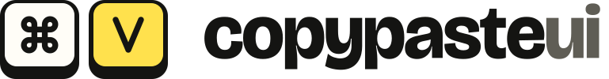

# CopyPasteUI brand

The idea in one line: **⌘V — paste a real design**. The mark is the two keys you press to paste, drawn as keycaps.
Yellow is the highlighter you'd run over the part that matters. Everything else is ink on paper.

## Logo files

All logos are SVG with the lettering converted to shapes, so they look the same everywhere with no fonts installed.

| File | Use it for |
| --- | --- |
| [`logo/wordmark.svg`](logo/wordmark.svg) | Default. Light backgrounds: site header, README, docs, slides |
| [`logo/wordmark-dark.svg`](logo/wordmark-dark.svg) | Dark backgrounds |
| [`logo/mark.svg`](logo/mark.svg) · [`mark-dark.svg`](logo/mark-dark.svg) | When the name is already next to it, or space is tight (⌘ V keys only) |
| [`logo/key-v.svg`](logo/key-v.svg) · [`key-v-dark.svg`](logo/key-v-dark.svg) | Smallest sizes: favicon, app icon, avatars |
| [`logo/key-command.svg`](logo/key-command.svg) | Decorative second key, e.g. stickers |
| `logo/*-black.svg` · `logo/*-white.svg` | One-colour printing, embossing, laser cutting, or on photos |

**Clear space:** keep at least the width of one key's corner radius (a fifth of a key) empty around the logo.
**Smallest size:** the wordmark at 20px tall on screens; below that use `mark.svg`, and below 24px use `key-v.svg`.

### Don't

- Stretch, rotate, outline or add shadows or glows to the logo.
- Recolour the keys (the yellow V and the white ⌘ stay as they are; use the one-colour files when you must).
- Set "copypasteui" in another font, add a capital C, or put a space or dot in it. In sentences, write **CopyPasteUI**.
- Put the light logo on a busy photo — use the white one-colour version on a dark overlay instead.

## Colours

| Name | Hex | Use |
| --- | --- | --- |
| Ink | `#141412` | Text, buttons, key bases, borders that matter |
| Paper | `#f5f3ec` | Page background |
| Card | `#fffdf7` | Cards, panels, the ⌘ key face |
| Highlighter | `#ffe14d` | The V key, highlights behind key words, the main accent. Never for text on paper (contrast too low) |
| Muted | `#5f5d55` | Secondary text, the "ui" in the wordmark |
| Rule | `#dcd8cb` | Hairlines and quiet borders |
| Night | `#121210` | Dark-mode background |
| Night text | `#f2efe4` | Text on Night |
| Night muted | `#a3a093` | Secondary text on Night |

On dark backgrounds the highlighter is used at about 38% opacity behind text so light text stays readable.

## Type

| Role | Font | Notes |
| --- | --- | --- |
| Display | **Bricolage Grotesque** ExtraBold (800), tight tracking (−3%) | Headlines and the wordmark |
| Text | **Hanken Grotesk** 400–600 | Body copy, UI |
| Mono | **JetBrains Mono** 500–600 | Code, labels in small caps, keycaps |

All three are free under the SIL Open Font License, from Google Fonts.

## Signature details

- **Keycaps:** a light face on a darker base with a thicker bottom edge, like a real key. Used for the logo, ⌘K hints and the paste chip.
- **Highlighter stroke:** a slightly slanted yellow band behind the lower half of one or two key words in a headline. One per heading, at most.
- **Hard offset shadow:** important panels get a solid 4–6px shadow in Ink or Highlighter, never a blurred one.
- **Paper slip:** prompts and copyable text sit on a card with a dashed border.

## Voice

Plain, specific and a little dry. Say what something does, with numbers, places and prices; skip startup words like
"seamless", "unlock", "supercharge" and "next-level". No emoji. The same rules our design check enforces on
contributed sections (see CONTRIBUTING.md, "Looks made by a person") apply to everything we write.

- Yes: "39 small-business websites. Free. One prompt each."
- No: "Unlock stunning websites with the power of AI ✨"

## Social and profile images

| File | Size | Where it goes |
| --- | --- | --- |
| [`social/avatar-500.png`](social/avatar-500.png) | 500×500 | GitHub organization, npm, X, Bluesky, Product Hunt avatar (safe when cropped to a circle) |
| [`social/avatar-yellow-500.png`](social/avatar-yellow-500.png) | 500×500 | Alternative avatar, e.g. Discord or YouTube |
| [`social/avatar-paper-500.png`](social/avatar-paper-500.png) | 500×500 | Avatar for light-themed places |
| [`social/github-social-preview-1280x640.png`](social/github-social-preview-1280x640.png) | 1280×640 | GitHub repo → Settings → Social preview |
| [`social/x-header-1500x500.png`](social/x-header-1500x500.png) | 1500×500 | X / Twitter header (your avatar covers the bottom-left, so the text sits right) |
| [`social/linkedin-banner-1584x396.png`](social/linkedin-banner-1584x396.png) | 1584×396 | LinkedIn page cover |
| [`social/og-default-1200x630.png`](social/og-default-1200x630.png) | 1200×630 | Plain share image for places without a page-specific one |

The website's favicon, Apple icon and per-page share images live in `apps/web/src/app` and `apps/web/public/og`
and follow the same rules.

## Rebuilding the files

The SVGs in `logo/` are the source of truth. To regenerate everything (for example after changing a colour):

1. Download the static fonts into `brand/source/fonts/`: Bricolage Grotesque ExtraBold (`bricolage-800.ttf`)
   and JetBrains Mono SemiBold (`jbmono-600.ttf`) from Google Fonts.
2. `npm i --no-save opentype.js@1.3.4 && node brand/source/logo.mjs` — writes `brand/logo/*.svg`.
3. `npm run build && npm run screenshots` (the banners use template screenshots), then
   `node brand/source/social.mjs` — writes `brand/social/*.png`.
